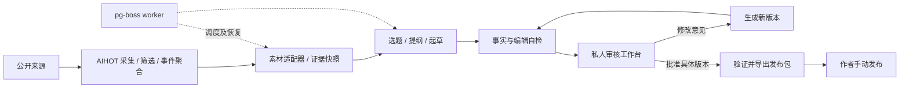

# 产品与技术设计

版本：0.1，2026-11-05。本文为待实施设计；功能任务、依赖和状态以 [Excel 实施计划](../../outputs/2026-11-05-plan/waibu_media_agent_功能实施计划.xlsx) 为准。当前没有运行中的产品服务。

## 1. 用户每天如何使用

系统持续收集公开资料，每天北京时间 08:30 自动挑选值得写的事件，整理来源、形成文章并自检。作者打开私人工作台，看到待审稿、选题理由和核实中的问题，可以直接编辑或提出修改意见。Agent 按意见生成新版本，作者确认版本后导出正文、标题摘要、封面和素材清单，手动发布到公众号。

默认每天最多 1 篇待审稿、展示最多 5 个候选题；待审积压达到 3 篇时暂停新的自动起草，继续采集和整理候选。没有合格题材时输出“今日暂无合格选题”和原因，不为完成数量编造文章。所有数字均为初始配置建议，需用试运行结果调整。

自动流程无需逐步向作者审批选题或提纲。只有确实缺少亲测材料、作者观点或关键事实时进入等待状态，其余题材可以继续处理。首版自动写资料分析与产品更新解读；实测、教程操作结果和第一人称观点必须有作者材料支持。

## 2. 范围

MVP 包含：公开 RSS/网页采集、候选题、证据快照、长文起草、自检、私人工作台、按意见改稿、版本批准、发布包导出、日调度及失败恢复。

后续再做：X/公众号付费源、图像生成、风格样本学习、货币预算硬限制。MVP 不实现自动上传或群发、多账号运营、公开资讯门户和无人值守的作者实测。OpenCode、DSH 是实现本项目的开发工具，生产 worker 直接调用模型 API，不依赖这些工具一直开着。

## 3. 架构选择

采用 AIHOT 固定版本源码 + `modules/waibu-editorial/`。复用三个进程和 PostgreSQL；复用模型网关、请求回执、调度及管理员会话。不上第二套任务框架。AIHOT 的资讯条目与公众号文章分开存储。



### 目录目标（实施后）

```text
apps/                         # 沿用上游 Web/API/worker
packages/                     # 沿用上游 backend/contracts
industry/                     # 来源、分类、资讯筛选提示词
site/                         # 品牌、模型、模块安装清单
modules/waibu-editorial/
  module.ts / server.ts / web.tsx
  contracts/                  # 本模块请求、状态与产物 schema
  backend/                    # sources / evidence / topics / workflow / drafts / review / export
  web/                        # 私人 layout、任务列表、审核、版本对比、运行页
  prompts/                    # 选题、提纲、起草、核查、改稿
  policy/                     # 可携带的账号规则及风格版本
  migrations/                 # waibu_ 前缀表，追加迁移
  tests/                      # fixture、集成及浏览器用例
docs/project/                 # 本项目设计，不被上游覆盖
docs/upstream/AIHOT/           # 引入时保存上游说明原件
docs/task-results/            # 开发 Agent 每项任务结果
outputs/2026-11-05-plan/       # Excel 主计划
```

页面建议为 `/editorial`、`/editorial/drafts/:id`、`/editorial/runs`，统一私人 layout。即使导航不显示，所有 loader、API 和图片/文件下载仍鉴权。上游公开页面首版只在受控网络访问，容器端口绑定回环或通过统一登录网关访问；不将已有公开资讯接口作为私人稿件入口。

## 4. 生产流水线

| 阶段 | 输入与行为 | 可追溯产物 / 退出条件 |
|---|---|---|
| 采集 | AIHOT 自带调度抓取配置来源 | 原始资料 ID、原始时间、抓取时间、来源级别 |
| 选题 | 按事件归组，结合近期进展、账号方向和历史文章 | 候选题、读者问题、独立角度、排除原因；无合格题可跳过 |
| 取证 | 回到原始页面，核对版本、数字、价格及发布日期 | 摘录、URL、时间、内容 hash、许可、事实到证据映射 |
| 提纲 | 证据与账号规则支持的中心问题 | 分段提纲、各段使用的 claim_id、缺口 |
| 初稿 | 提纲、已核实事实、作者材料 | 结构化标题、摘要、段落、图注、引用映射 |
| 自检 | 确定性检查 + 模型提出问题 | 硬错误阻断；有限修改最多 2 轮，仍不满足转待处理 |
| 待审核 | 作者阅读正文、来源和修订差异 | 批注、直接编辑、驳回或批准某一 revision |
| 改稿 | 基准 revision + 作者意见 | 新 revision、逐项回应、原有已确认事实保留 |
| 导出 | 有效批准版本 | 版本绑定的发布包与校验报告 |
| 发布登记 | 作者明确提供发布时间/链接 | 发布记录；不由导出动作推断 |

选题首先过证据、相关性和重复性门槛，再按新进展、实用价值和可写性排序。热度只是输入，不能代替事实可信度。评分维度、权重和门槛入配置；初版不声称已校准。手工挑选的固定样本用于评测，生产选择和评测样本分开。

证据来源以官方公告、文档、源码和论文优先；不能机械要求每个事实都有两条来源。一条清晰一手发布可以支持发布事实，多家转载同一原文不算独立交叉验证。冲突事实标为 disputed；缺正文或只有二手摘要时不能编出具体技术结论。

## 5. 状态与版本

分离文章状态和任务运行状态，避免把网络故障当成稿件被驳回。

文章状态：`drafting → checking → in_review → approved → exported → published`。

- `in_review → revising → checking → in_review`：人工改稿意见触发。
- 任一未发布状态可 `on_hold`（材料不足）或 `rejected`（作者放弃）；补材料后回到所需阶段。
- `approved/exported` 后发生内容变化：创建新版本，清除“当前批准”指针，回到 checking；保留旧批准和旧包作审计，禁止再作为当前正式包下载。
- 来源撤回或关键事实失效：未发布稿转 on_hold，撤销当前有效批准；已发布稿生成“待勘误”提醒，保留发布事实，不自动改写或发布。
- 已发布文章的新修改使用新的修订流程，不覆盖历史发布版本。

任务状态：`queued/running/succeeded/failed/paused_budget/waiting_input/cancelled`。任务失败不删除上一版可读草稿。生成任务带 `base_revision_id`；回写时比较当前版本，旧任务结果可保留为分支产物，但不替换作者最新版本。

人工批准时服务器事务验证：请求人身份、预期版本、当前 revision、完整内容 hash、自检阻断项、来源有效性。批准后的正式导出再次检查同样的版本及来源条件。模型或 worker 不能自行创建批准记录。

## 6. 数据实体

以下为逻辑契约，物理 SQL 由任务 F02/F04 固化；ID 使用 UUID，时间存 timestamptz，展示及业务日期统一 Asia/Shanghai。

| 实体 | 关键字段 | 约束 |
|---|---|---|
| `waibu_runs` | id、business_date、mode、pipeline_version、status、input_hash、error_code | 定时 run 按日期及管线版本唯一；人工重跑独立 request_id |
| `waibu_steps` | run_id、stage、input_hash、attempt、status、receipt_id、output_ref | 同一阶段输入成功后复用；token、耗时和错误可追踪 |
| `waibu_topics` | id、story_ids、angle、reason、evidence_status、dedupe_key | 同事件同角度不重复起草；新进展附具体证据 |
| `waibu_evidence` | id、source_id、article_id、url、published_at、fetched_at、excerpt、hash、rights、validity | 证据快照不覆盖；变化新增版本，来源状态单独更新 |
| `waibu_claims` | id、topic_id、text、evidence_ids、status、checked_at | factual/inference/author_opinion 分类；核查状态与模型分数分开 |
| `waibu_drafts` | id、topic_id、state、current_revision_id、approved_revision_id、lock_version | 当前指针事务更新；禁止直接覆盖历史内容 |
| `waibu_revisions` | id、draft_id、parent_id、title、summary、body、assets、content_hash、policy_version、created_by | 内容不可变；hash 覆盖标题、摘要、正文、封面、图注及素材 hash |
| `waibu_revision_claims` | revision_id、block_id、claim_id | 正文事实映射到证据；复制正文中不显示内部 ID |
| `waibu_feedback` | id、revision_id、block_id、text、resolution_revision_id | 批注必须绑定版本；无法定位时明确提示 |
| `waibu_approvals` | id、revision_id、content_hash、actor、approved_at、revoked_at、reason | 仅人工端可写；一份当前有效批准 |
| `waibu_assets` | id、hash、path、mime、dimensions、origin、rights | 文件在私有持久卷；下载鉴权；未知授权不进正式包 |
| `waibu_exports` | id、revision_id、approval_id、manifest_hash、path、validator_version、status | 导出任务幂等；失败不标 exported |
| `waibu_publications` | id、revision_id、channel、published_at、url、recorded_by | 作者明确登记；正文状态与外部事实分开 |

不复制整套 AIHOT 数据库；通过素材适配器读取已有 article/story。快照用于稿件审计与后续变更检测，保留必要摘录；全文、作者材料与日志设置明确保留期。清理任务不能删除有效稿件/发布记录引用的证据和素材，备份按同样边界管理。

## 7. 拟定 API

统一前缀 `/api/admin/editorial`，以下全部鉴权；所有写请求带 CSRF。重复命令用 `Idempotency-Key`；修改命令带 `expectedRevisionId` / `expectedLockVersion`，冲突返回 409。API 只入队，返回 202 + jobId，不同步等待模型。

| 方法与路径 | 功能 |
|---|---|
| `GET /topics`、`GET /drafts`、`GET /runs/:id` | 候选、稿件队列、运行及阶段状态 |
| `POST /runs` | 手动执行与故障恢复，默认不突破数量/预算限制 |
| `GET /drafts/:id`、`GET /drafts/:id/revisions` | 当前稿、证据、完整修订历史 |
| `POST /drafts/:id/revisions` | 保存作者直接编辑的新版本并重新自检 |
| `POST /drafts/:id/feedback` | 保存批注并请求基于指定版本改稿 |
| `POST /drafts/:id/approvals` | 人工批准当前 revision 和 hash |
| `POST /drafts/:id/reject` | 人工驳回及原因 |
| `POST /drafts/:id/exports` | 为有效批准版本创建导出任务 |
| `GET /exports/:id/download`、`GET /assets/:id` | 有权访问的发布包与素材，no-store |
| `POST /drafts/:id/publications` | 作者手动登记发布记录 |

接口 schema、错误码、任务 payload、数据模型在并行实现前由 F02 冻结为 v1；各分支可通过 fixture 开发。更改共享契约必须先发布兼容变更，再同步所有消费者，不能分别猜字段。

## 8. 任务可靠性与费用

cron 只创建 run 与阶段任务。事务内插入业务记录并 `enqueueOn`；worker 外部调用不在长数据库事务里执行。阶段键覆盖证据 hash、策略/提示词版本、模型配置、基准稿版本和改稿意见；恢复同一输入不生成新身份。

每个阶段分别重试，瞬时错误有限退避；预算不足标 paused_budget，材料不足标 waiting_input，schema 或事实错误最多修复 2 次。不得用无限“自我反思”循环消耗费用。run 重启只恢复未完成阶段。手动重新生成与故障恢复是不同命令，前者创建新 request_id。

先复用上游每分钟/小时/天请求上限；另设置单稿调用次数、输出 token 上限和运行时长。记录 usage 和估算费用，未知价格显示 unknown，不显示 0 元。货币预算硬熔断列为后续任务，不能在 MVP 宣称已提供。若服务商支持账户硬限额，部署时配合使用。

每日任务补跑只补最近一个业务日；历史范围需明确人工指定，避免恢复上线后补写大量旧文。采集保留各源频率，08:30 起草使用已到达资料，不等待所有来源成功。

## 9. 私人工作台与发布包

工作台提供待审核、改稿中、已批准/可导出、异常任务和候选题；审核页显示正文、证据抽屉、版本差异和意见栏。移动端应能阅读和批准，复杂编辑可在桌面完成。先支持 Markdown/分段文本编辑，暂不做复杂富文本编辑器。

正式包：`正文.md`、`标题与摘要.md`、`配图/`、`排版/正文.html`、`排版/预览.html`、`排版/纯文字.txt`、`信源与素材清单.md`、`发布说明.md`、`验证/`、`manifest.json`。manifest 包含 revision_id、content_hash、文件 hash、渲染与校验版本。

无可用配图时使用明确为设计图的简洁文字封面，不生成假产品截图。正文不加外部超链接；来源用普通文字归属，完整 URL 留在清单。图片本地路径不代表已上传微信，发布说明应写清作者需上传图片。

复制按钮和选择复制两条路径均验证真实剪贴板 HTML；检查手机/桌面布局、图片宽高、正文无链接、来源归属保留。引入当前微信官方开源结构校验器并锁版本，不能修改规则求通过。本地通过、校验器通过、公众号后台验证三个状态分别记录；只有真实测试过才标通过。

## 10. 配置与待定项

初始可用默认：AI 编程/工具/人与 AI 协作方向；Asia/Shanghai；08:30；1 篇/日；5 个候选；待审上限 3；自动修复最多 2 轮。规则配置保存版本并写入每次生成记录。

真实运行前待作者提供：模型供应商/凭据和可接受预算、部署机器、重点信源与排除范围、首批风格样本。缺这些信息不阻塞 fixture 驱动的开发；真实付费试运行与上线单列验收，不由 Agent 编造配置或偷偷启用。

MVP 验收重点：从固定来源样本到审核、修改、批准及导出完整走通；无越权读取；无旧任务覆盖；重复投递不重复生成；故障恢复保留结果；事实和图片来源可查。随后在真实数据上连续观察 7 天，记录草稿可用率、人工修改量、失败类型、实际调用和成本，再调整选题策略。
